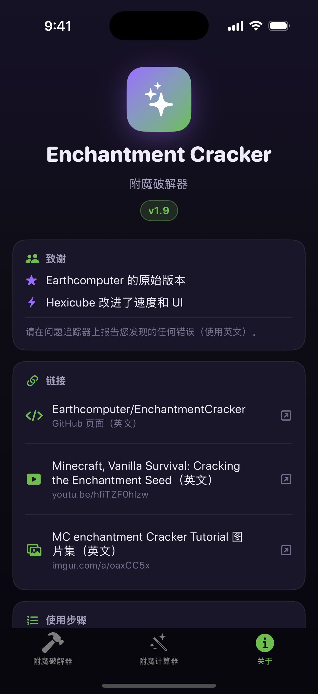

# Enchantment Cracker for iOS（附魔破解器 iOS 版）

[Earthcomputer/EnchantmentCracker](https://github.com/Earthcomputer/EnchantmentCracker) 的原生 iOS 移植版。
原版是用 Java + Swing 写的桌面程序，iOS 无法直接运行 Java，因此这里把**全部算法用 Swift 重新实现**，
界面用 SwiftUI 重写，并提供一个纯 Swift 的附魔台模拟器（不依赖任何原生库）。

- 纯 Swift / SwiftUI，无第三方依赖，最低支持 **iOS 16.0**
- 完整移植：Java `Random`（LCG）克隆、附魔等级计算、附魔台附魔生成、
  版本差异（1.8 ~ 1.21.11）、XP 种子破解（并行扫描全部 2³² 个种子）、玩家种子反推、
  附魔计算器（算出还要丢几件物品）
- 每次提交都由 **GitHub Actions（macOS 运行器 + Xcode）** 自动编译并打包成**未签名 IPA**
- 算法正确性由 `ci/` 里的 **Java 参考向量** 逐项校验：`verify/` 里的 Swift 验证程序
  会把 Swift 实现的计算结果与原版 Java 代码的输出逐条比对

## 截图

| 附魔破解器 | 附魔计算器 | 关于 |
| --- | --- | --- |
|  |  |  |

实际破解结果（模拟器里跑完整 2³² 扫描，约 100.7M 个可能种子，与原版 Java 完全一致）：


## 下载与安装

IPA 在 [Releases](https://github.com/StarrySkyehk/EnchantmentCracker_ipa/releases) 页面，
文件名形如 `EnchantmentCracker.ipa`。**这是未签名 IPA**，需要自己签名安装，方式任选一种：

| 工具 | 适用情况 | 说明 |
| --- | --- | --- |
| **Sideloadly**（Windows/macOS） | 有电脑，最常见 | 装好后连上 iPhone，把 IPA 拖进去，填自己的 Apple ID，点 Start。免费 Apple ID 签名的应用 **7 天后过期**，重装一次即可 |
| **AltStore / SideStore** | 想在手机上续签 | 需要 AltServer 或配对文件，签名同样 7 天过期，可自动续签 |
| **TrollStore** | iOS 14.0 ~ 17.0（不含 17.0.1+） | 支持未签名 IPA 直接安装，不用 Apple ID，不过期 |
| **爱思助手 / i4Tools 等** | 国产助手 | 工具箱里选 "IPA 签名" 或用 "一键越狱/签名安装"，填 Apple ID 自签 |

> 签名用的 Apple ID 只是本机自签，不会上传到 App Store，也不需要付费开发者账号。
> 免费账号的限制是：应用 7 天过期、最多同时 3 个自签应用。

## 使用方法（和原版一致）

### 第一步：破解 XP 种子

1. 打开游戏里的附魔台，**不要放物品**，看三个附魔选项右上角显示的经验等级，
   记下 **书架数量** 和 **三个等级**。
2. 在上表填入「书架」「第 1/2/3 格」，点 **检查**。
   - 第一次检查需要完整扫描 2³² 个种子，iPhone 上大约 **10 ~ 40 秒**（有进度条，可取消）。
   - 结果可能是「可能的种子数」还有几千万/上亿个。
3. **拆掉或补上一些书架**，再去看一次三个等级（XP 种子不会变），把新的书架数和等级填进去再点 **检查**。
   重复 2 ~ 3 次，剩下的可能种子会收敛到 **1 个**，界面会显示 `XP种子：XXXXXXXX`。
4. 想继续算下一步（附魔计算器）还需要 **玩家种子**：
   再打开一次附魔台，把两次看到的 XP 种子分别填进「XP种子 1」「XP种子 2」，
   点 **计算种子** → 得到 12 位十六进制的 **玩家种子**。
   （破解出唯一 XP 种子时，程序会自动把第一个填好。）

> 提示：如果点 **检查** 后显示的数量很大、并且提示"会重新完整扫描"，这是正常的——
> 手机内存放不下上亿个候选种子，程序会直接用全部观测重新扫一遍。

### 第二步：附魔计算器

1. 选 **材料 / 物品**、**最大书架数**、**玩家等级**（可以填 999 表示不限）。
2. 在「目标附魔」里给要的附魔选最低等级（I ~ V），不想要的选「不要」，无所谓的保持「无要求」。
3. 点 **计算** → 得到：**抛出物品数 / 书架数 / 附魔格**。
   按这个结果先丢对应数量的物品（每丢一件都会推进种子），再用指定书架数量在指定格子附魔即可。
4. 附完点 **完成**，程序会自动推进玩家种子和剩余等级，可以接着算下一次。

## 从源码构建

仓库里没有 `.xcodeproj`（它由 `project.yml` + [XcodeGen](https://github.com/yonaskolb/XcodeGen) 生成），
所以在 macOS 上：

```bash
brew install xcodegen
xcodegen generate
open EnchantmentCracker.xcodeproj      # 用 Xcode 打开，选自己的设备签名运行
```

或者直接用命令行打包未签名 IPA：

```bash
xcodegen generate
xcodebuild -project EnchantmentCracker.xcodeproj -scheme EnchantmentCracker \
  -configuration Release -sdk iphoneos -derivedDataPath build \
  CODE_SIGNING_ALLOWED=NO CODE_SIGNING_REQUIRED=NO CODE_SIGN_IDENTITY="" build
mkdir -p Payload && cp -R build/Build/Products/Release-iphoneos/EnchantmentCracker.app Payload/
zip -qry EnchantmentCracker.ipa Payload
```

### GitHub Actions 自动构建

| 工作流 | 作用 |
| --- | --- |
| `.github/workflows/build-ipa.yml` | 在 `macos-15` 上跑 XcodeGen + `xcodebuild`，把 `.app` 打成未签名 `.ipa`，上传 artifact（保留 90 天） |
| `.github/workflows/verify.yml` | 用 `swiftc` 编译 `verify/main.swift`，把 Swift 实现和 Java 参考向量逐条比对；另有一个跑分任务测破解速度 |

手动触发（`workflow_dispatch`）：

```bash
gh workflow run build-ipa.yml --ref main
gh workflow run verify.yml --ref main
```

## 算法正确性验证

`ci/ReferenceVectors.java` 直接调用**原版 Java 源码**，把下面这些结果导出成 JSON：

- `levelsToXP`、每个附魔的 `getMaxLevel` / 最小/最大附魔能力 / 权重 / 可应用物品 / 是否互斥
- 每个物品的附魔能力、附魔台可获得的最大等级
- `getEnchantmentsInTable`：给定 XP 种子、物品、格子、等级、版本时生成的附魔列表（84 组）
- 玩家种子反推（5 组）、附魔计算器搜索结果（10 组）
- **种子破解**：4 组观测的精确匹配数量 + 首/末 5 个匹配种子

`verify/main.swift` 用 Swift 实现重算这些值并逐条比对，任何不一致都会以 `FAIL ... expected X, actual Y` 输出并让 CI 失败。

当前状态：**15 个分组、8,000+ 项检查全部 PASS**（含 4 组种子破解的精确匹配数量：100,663,118 / 1,310,611 / 23,255,942 / 0）。
破解速度（GitHub Actions `macos-15`，3 vCPU）：单次完整 2³² 扫描 **14.6 s ≈ 2.95 亿种子/秒**。
重新生成参考向量：

```bash
javac -d ci/build ../enchcracker-src/src/enchcracker/{Versions,Materials,Items,Enchantments,SimpleRandom,IntArray,Log}.java \
      ../enchcracker-src/src/enchcracker/cracker/{AbstractSingleSeedCracker,JavaSingleSeedCracker}.java ci/ReferenceVectors.java
cd ci && java -Xmx3G -cp build ReferenceVectors vectors/reference_vectors.json
```

## 目录结构

```
Sources/
  App.swift                  应用入口
  Core/
    CrackerModel.swift       界面状态机（@Published 状态 + 破解/计算调度）
    Engine/                  纯 Swift 算法层（只依赖 Foundation，可在命令行单独编译）
      SimpleRandom.swift     java.util.Random 的等价实现
      MCVersion.swift        Minecraft 版本枚举
      Items.swift            物品 / 材料 / 附魔能力表
      Enchantments.swift     附魔台规则（全部版本）
      SeedCracker.swift      2³² XP 种子并行破解
      Calculator.swift       玩家种子反推 + 附魔计算器
  UI/                        SwiftUI 界面（三个 Tab）
ci/                          Java 参考向量生成器 + 生成的 JSON
verify/                      Swift 端验证程序
bench/                       破解速度跑分
```

## 版权 / License

原项目 [Earthcomputer/EnchantmentCracker](https://github.com/Earthcomputer/EnchantmentCracker)
采用 **GPL-3.0**，本移植版同样以 **GPL-3.0** 发布，见 [LICENSE](LICENSE)。
算法与界面逻辑来自原作者 Earthcomputer 与 Hexicube，iOS 移植仅做平台适配。
请勿将本程序用于商业用途或违反服务器规则。
